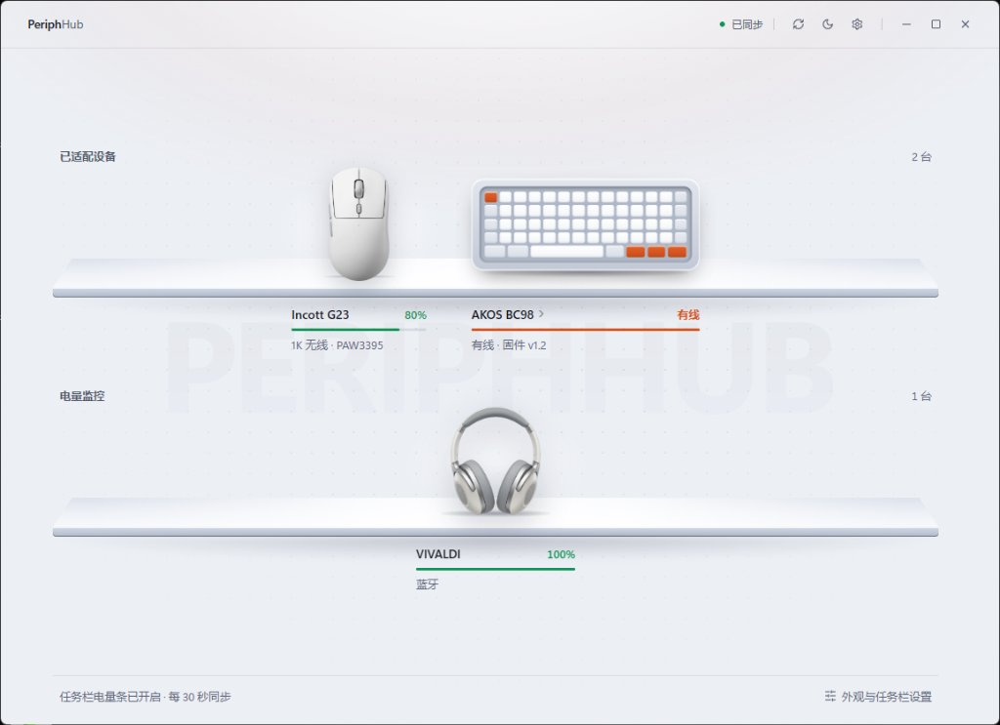
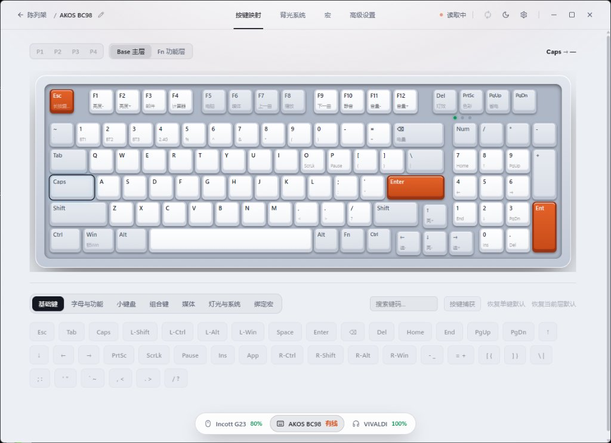
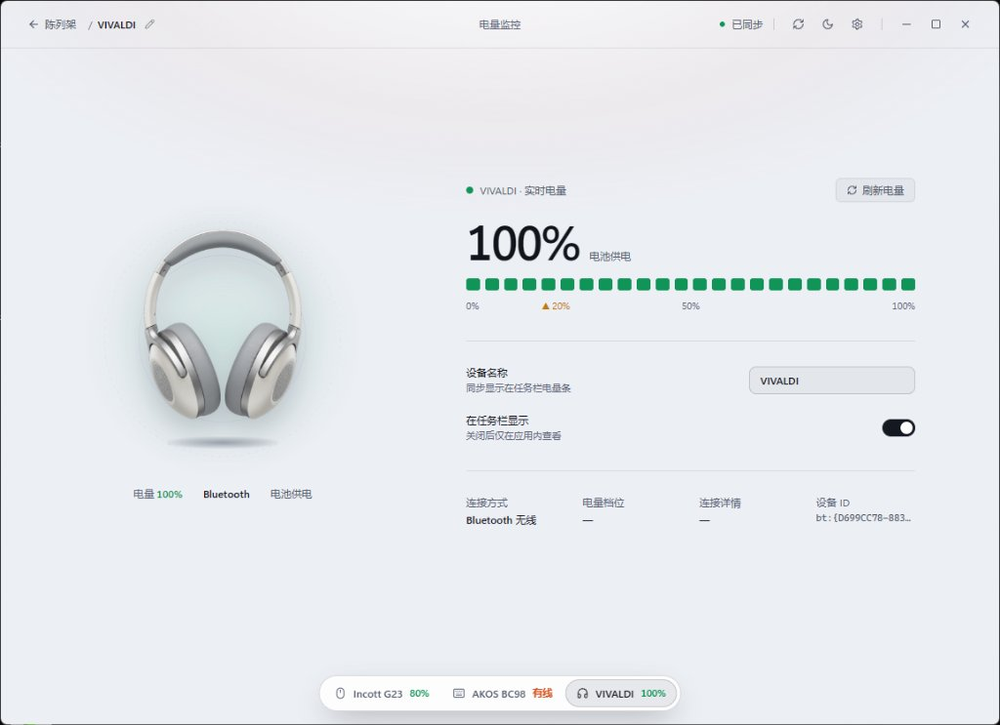

# PeriphHub

轻量、纯离线的 Windows 外设电量监控与驱动控制中心（C++17 + WebView2 单文件分发）。

[](#快速开始)
[](#从源码编译与扩展)
[](LICENSE)

> **关于项目**：PeriphHub 是个人独立开源项目，内置驱动围绕作者自用的几款鼠键适配（**Incott G23、Ksnake X11、ROYUAN AKOS BC98**），并非全品牌通用驱动。如果你想接入自己的设备，仓库已留好外部电量探针接口、驱动注册规范与开发文档。



| 键盘驱动工作台（98 键改键 / 宏 / 灯效） | 通用蓝牙外设电量监控 |
|---|---|
|  |  |

> 任务栏常驻电量条效果：

## 为什么用 PeriphHub

- **只安装一个驱动**：用这一个轻量的单文件程序，替代桌面上一堆常驻的官方驱动后台（已适配设备开箱即用，未适配设备可按规范自行扩展）。
- **统一管理**：鼠标、键盘的常用设置（DPI、回报率、改键、板载宏、灯效等）收拢到同一个界面里调，不用在多个软件间切来切去。
- **电量可视化**：聚合自有驱动、蓝牙 / BLE、HID 电量、XInput 手柄及外部探针的数据，通过动态托盘图标和任务栏半透明电量条直观展示，低电量及时提醒。
- **纯离线、单文件**：界面与运行时全部打包进单个 `PeriphHub.exe`，不联网、不监听本地端口，配置只写在本机，拷贝即用。
- **可拓展**：想单纯接入新设备电量，写个输出 JSON 的外部探针即可免编译接入；想深度适配新鼠键，也可基于内置驱动层与能力声明规范扩展，无需重写外壳与 UI。

## 支持设备与使用边界

> **先说清楚边界**：未列出的型号默认视为未适配——哪怕能通过系统协议读出电量，也不代表能改 DPI、改键或写宏。

### 1. 完整驱动控制（已适配）

| 设备 | 支持功能 | 实测情况 |
|---|---|---|
| **Incott 鼠标**（G23 / G24） | 电量、DPI（含分轴）、回报率、传感器参数、6 键映射、板载宏（兼容 Studio JSON）、灯效 | **G23** ✅ 日常主力实测；G24 仅协议兼容，未实测 |
| **Ksnake 鼠标**（X11） | 电量、充电状态、DPI、回报率、按键映射、板载宏、灯效 | **X11** ✅ 日常主力实测；其他 YJX 方案型号未验证 |
| **ROYUAN 键盘**（AKOS BC98） | 2.4G / 蓝牙电量、多配置档、全键改键（含 Fn 层）、板载宏、主/侧 RGB 灯效、防抖与休眠 | **AKOS BC98** ✅ 日常主力实测；其他型号未验证 |

### 2. 通用电量监控（零配置，仅看电量）

不区分具体品牌，只要设备符合以下任一标准接口即可自动显示电量：

- **蓝牙 / BLE 外设**：支持 Windows 标准蓝牙电量服务（`0x180F` Battery Service），如蓝牙耳机、键鼠、触控板等，系统配对后自动出现
- **标准 HID 电量设备**：遵循系统 HID Battery 规范的无线外设
- **游戏手柄**：支持 Xbox / XInput 协议手柄（`xinput1_4.dll`）
- **无线游戏耳机（可选）**：若本机已配置 [`headsetcontrol`](https://github.com/Sapd/HeadsetControl)，可自动聚合其支持的各品牌无线耳机电量
- **外部电量探针**：通过 `battery-probe.exe --json` 接入任意私有协议设备的电量与在线状态

> **使用小贴士**：无线鼠标通常在 60–90 秒无操作后进入浅休眠，此时驱动读写会提示未唤醒——动一下鼠标再刷新或保存设置即可。

## 快速开始

### 运行要求
- **系统**：Windows 10 / Windows 11（64 位）
- **运行时**：Microsoft Edge WebView2 Runtime（Windows 11 自带，大多数 Windows 10 也已预装；缺失时程序会自动提示）

### 使用步骤
1. 前往 [Releases](https://github.com/aining1670-lgtm/PeriphHub/releases) 下载 `PeriphHub.exe`，放到任意文件夹（单文件绿色版，无需安装）。
2. 双击运行：程序会自动驻留系统托盘，并在任务栏显示外设电量条。
3. **日常操作**：
   - **系统托盘图标**：鼠标悬停查看电量；**双击**打开设置界面；**右键**可快速切换设备列表、立即刷新、开关任务栏电量条或退出。
   - **任务栏电量条**：点击任意设备即可直达对应设置页；不喜欢常驻也可以在设置里关掉，或调整堆叠样式、圆角底板与品牌配色条。
   - **设置项即时生效**：开机自启、低电量弹窗、设备别名以及 DPI / 改键 / 宏 / 灯效等调整后直接保存生效，无需重启软件。

> **关于 Windows 安全提示**：因为是个人开源的未签名程序，首次双击可能会弹出 SmartScreen 拦截提示，点「更多信息」→「仍要运行」即可；如果不放心也可以按下方步骤自行从源码编译。

## 从源码编译与扩展

### 编译环境
- MSYS2 / MinGW-w64（`g++` C++17、`windres`、`make`）
- Node.js 20+（仅修改 `web-next/` 前端源码或运行 `--bridge` 契约检查时需要；仓库已内置编译好的单文件 `web/index.html`，纯编译 C++ 可直接运行 `make`）

```bash
export PATH="/c/msys64/usr/bin:/c/msys64/mingw64/bin:$PATH"

# （可选）修改 web-next/ 前端源码后重新生成单文件 web/index.html
(cd web-next && npm install && npm run build && cp dist/index.html ../web/index.html)

make          # 编译 build/PeriphHub.exe
make test     # 运行硬件无关的 C++ 单元测试
make dist     # 打包单文件独立可执行程序到 dist/PeriphHub/PeriphHub.exe
```

### 扩展你自己的设备
- **只接入电量显示**：参考 [外部电量探针协议](docs/09-external-probe.md) 与示例 [`examples/battery-probe/battery_probe.cpp`](examples/battery-probe/battery_probe.cpp)，用任意语言实现一个 `battery-probe.exe --json` 即可免编译接入。
- **接入完整鼠标/键盘驱动**：参考 [添加新设备指南](docs/10-adding-a-device.md)、[系统架构说明](docs/01-architecture.md) 与 [Web 控制台架构](docs/11-web-console-architecture.md)，在 `native/src/drivers/` 下注册新驱动并声明 `capabilities`，无需重写托盘、任务栏电量条与 WebView2 界面。

<details>
<summary>常用命令行参数（点击展开）</summary>

```powershell
.\PeriphHub.exe                # 启动托盘与任务栏电量条
.\PeriphHub.exe --settings     # 启动并打开设置窗口（已运行则唤起原窗口）
.\PeriphHub.exe --list         # 列出已识别外设及电量
.\PeriphHub.exe --list-json    # 以 JSON 格式输出外设状态
.\PeriphHub.exe --bridge '{"id":1,"cmd":"device.probe"}'  # 单次 IPC 桥请求
.\PeriphHub.exe --help         # 查看完整命令行帮助
```

完整桥协议说明见 [Bridge 协议文档](docs/02-bridge-protocol.md)。

</details>

## 常见问题

- **电量一直显示 `--` 或设备没出现？** 多半是设备进入浅休眠，动一下鼠标/键盘再刷新；蓝牙设备需确认系统蓝牙已开启并已配对。
- **双击没反应？** 程序是单实例运行，可能已在系统托盘后台运行；再次运行会唤起已有设置窗口。
- **配置和宏存在哪？** 设置保存在注册表 `HKCU\Software\PeriphHub`，宏库和别名文件在 `%LOCALAPPDATA%\PeriphHub\`；把 `macros.ini` / `aliases.json` 放在 exe 同目录可实现便携模式。

## 致谢与声明

- PeriphHub 为个人独立开源项目，与 Incott、AKOS、ROYUAN 及其他外设品牌均无隶属或官方背书关系。
- 任务栏电量条的绘制（`native/src/widget.cpp`）及品牌配色/图标表（`native/src/brands.cpp`）派生自 [krisgfx9/Wireless-Device-Battery-Monitor](https://github.com/krisgfx9/Wireless-Device-Battery-Monitor)（GPL-3.0，原仓库已下线），其余外设驱动、协议层、宏系统与 WebView2 界面均为本项目独立实现。第三方组件与开源署名详情见 [`THIRD_PARTY_NOTICES.md`](THIRD_PARTY_NOTICES.md)。

## License

本项目基于 [GNU General Public License v3.0 (GPL-3.0)](LICENSE) 开源。
